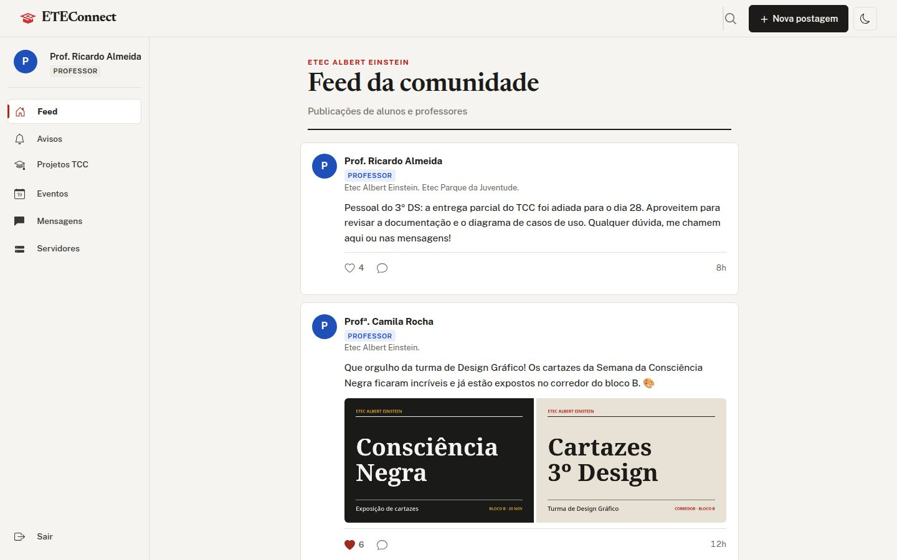
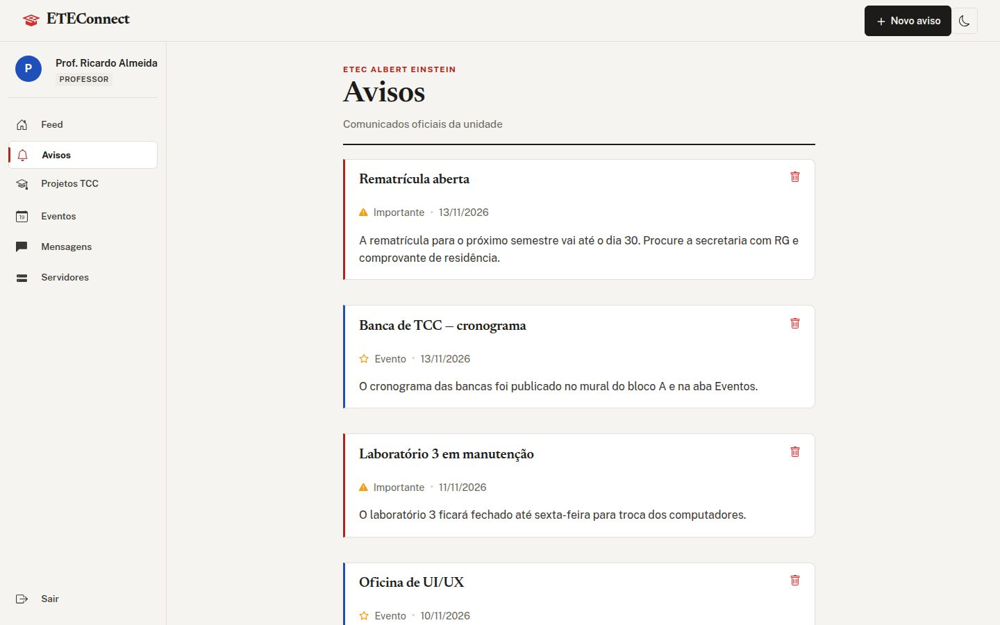
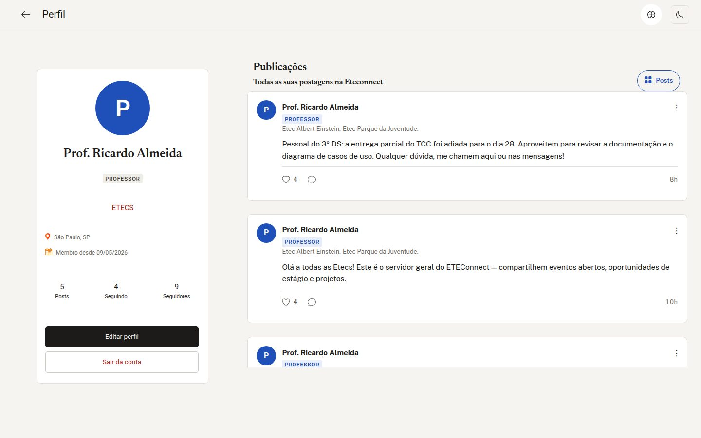

# ETEConnect

Academic social network for students and teachers of the Etecs (Centro Paula Souza, São Paulo's public technical schools), built as a final course project (TCC).

**Features:** per-campus feed (servers), posts with images/videos, likes and threaded comments, announcements, events with registration, a showcase of final projects, direct messages, followers, editable profile and light/dark theme.

**Stack:** PHP 8 (AltoRouter + REST API with JWT/refresh tokens), MariaDB/MySQL, plain HTML/CSS/JS with Bootstrap.

> The interface is in Portuguese.









<p align="center">
  
  
</p>

---

## Dependencies

**With Docker (recommended):** you only need [Docker](https://docs.docker.com/get-docker/) with Docker Compose. Everything else (PHP, Apache, database) runs in containers.

**Without Docker:**

| Dependency | Version | Notes |
|---|---|---|
| PHP | 8.1+ | extensions `pdo_mysql`, `openssl`, `fileinfo`, `mbstring` |
| Apache | 2.4 | `mod_rewrite` enabled and `AllowOverride All` (routing uses `.htaccess`) |
| MySQL / MariaDB | 8.0+ / 10.6+ | database `tcc`, charset `utf8mb4` |
| Composer | 2.x | optional: the `vendor/` folders are already in the repository |

PHP libraries (via Composer):

- [`altorouter/altorouter`](https://github.com/dannyvankooten/AltoRouter): page routing (`/composer.json`)
- [`firebase/php-jwt`](https://github.com/firebase/php-jwt): JWT authentication (`/backend/composer.json`)
- [`phpmailer/phpmailer`](https://github.com/PHPMailer/PHPMailer): password recovery email

Front end: Bootstrap 5 (bundled in `frontend/static/bootstrap`), Google Fonts (Nunito and DM Sans) and Font Awesome via CDN.

---

## How to run

### Option 1: Docker

```bash
git clone https://github.com/cauekkz/eteconnect.git
cd eteconnect
docker compose up -d --build
```

| Service     | Address                 |
|-------------|-------------------------|
| Site        | http://localhost:8080   |
| phpMyAdmin  | http://localhost:8081   |
| MariaDB     | localhost:3307 (user `root`, password `root`) |

On the first start, the database is created and populated automatically from `backend/DDL.sql`, `DML.sql` and `seed.sql`.

Useful commands:

```bash
docker compose logs -f app              # PHP/Apache logs
docker compose down                     # stop
docker compose down -v && docker compose up -d   # recreate the database from scratch
```

> On Fedora/RHEL (SELinux) the volumes already use the `:z` suffix. If ports 8080, 8081 or 3307 are taken, change them in `docker-compose.yml`.

### Option 2: XAMPP / local Apache

1. Copy the project to the server root (e.g. `C:\xampp\htdocs\`). The site must live at the **root** of the domain (`http://localhost/`), because routes are absolute.
2. Enable `mod_rewrite` and make sure `AllowOverride All` is set in `httpd.conf`.
3. Create the database and import, in this order:
   ```bash
   mysql -u root -e "CREATE DATABASE tcc CHARACTER SET utf8mb4 COLLATE utf8mb4_unicode_ci"
   mysql -u root tcc < backend/DDL.sql
   mysql -u root tcc < backend/DML.sql
   mysql -u root tcc < backend/seed.sql   # demo data (optional)
   ```
4. If your MySQL uses a different user/password, set the environment variables below (or change the defaults in `backend/_inc/config.php`).
5. On MySQL 8 (not MariaDB), disable `ONLY_FULL_GROUP_BY`:
   `SET GLOBAL sql_mode = 'STRICT_TRANS_TABLES,NO_ENGINE_SUBSTITUTION';`

### Demo accounts

Password for all of them: `Etec@2025`

| Role | Email | Can |
|---|---|---|
| Student | `aluno@etec.sp.gov.br` | see the feed, like, comment, message, join events |
| Teacher | `professor@etec.sp.gov.br` | all of the above + post, create announcements, events and projects |

There are 14 more users in the seed (listed in `docker/seed/generate_seed.py`). To regenerate the data: `python3 docker/seed/generate_seed.py` (images are generated by `generate_images.py`, which needs Pillow).

### Environment variables

| Variable | Default | Used for |
|---|---|---|
| `MYSQL_HOST` / `MYSQL_DBNAME` / `MYSQL_USER` / `MYSQL_PASS` | `localhost` / `tcc` / `root` / empty | database connection |
| `JWT_SECRET` | development value | token signing (**change it in production**) |
| `OPENSSL_KEY` / `OPENSSL_IV` | development values | auxiliary encryption |
| `SMTP_USER` / `SMTP_PASS` | empty | Gmail account + app password for "Forgot password" |

With Docker, set `SMTP_USER`/`SMTP_PASS` in your shell (or in a `.env` file) before `docker compose up`.
