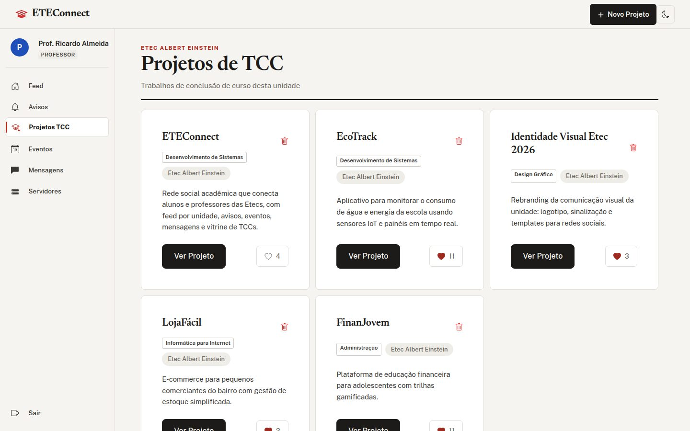
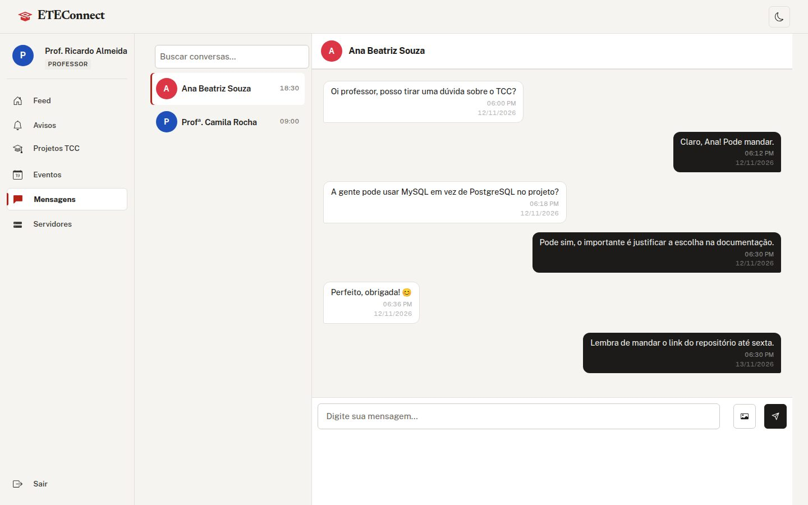
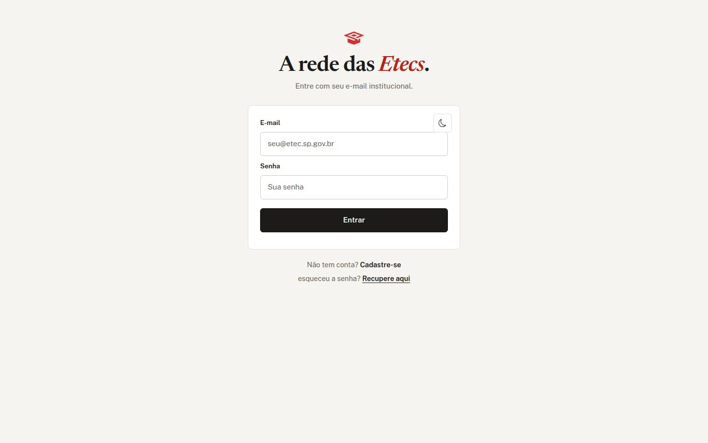

# ETEConnect

Rede social acadêmica para alunos e professores das Etecs (Centro Paula Souza), desenvolvida como Trabalho de Conclusão de Curso.

**Funcionalidades:** feed por unidade (servidores), publicações com imagens/vídeos, curtidas e comentários com respostas, avisos, eventos com inscrição, vitrine de projetos de TCC, mensagens diretas, seguidores, perfil editável e tema claro/escuro.

**Stack:** PHP 8 (AltoRouter + API REST com JWT/refresh token), MariaDB/MySQL, HTML/CSS/JS puro com Bootstrap.








<p align="center">
  
  
</p>

---

## Dependências

**Com Docker (recomendado):** só precisa do [Docker](https://docs.docker.com/get-docker/) com o Docker Compose. O resto (PHP, Apache, banco) roda nos containers.

**Sem Docker:**

| Dependência | Versão | Observação |
|---|---|---|
| PHP | 8.1+ | extensões `pdo_mysql`, `openssl`, `fileinfo`, `mbstring` |
| Apache | 2.4 | `mod_rewrite` ativo e `AllowOverride All` (o roteamento usa o `.htaccess`) |
| MySQL / MariaDB | 8.0+ / 10.6+ | banco `tcc`, charset `utf8mb4` |
| Composer | 2.x | opcional: as pastas `vendor/` já estão no repositório |

Bibliotecas PHP (via Composer):

- [`altorouter/altorouter`](https://github.com/dannyvankooten/AltoRouter): rotas das páginas (`/composer.json`)
- [`firebase/php-jwt`](https://github.com/firebase/php-jwt): autenticação JWT (`/backend/composer.json`)
- [`phpmailer/phpmailer`](https://github.com/PHPMailer/PHPMailer): e-mail de recuperação de senha

No front: Bootstrap 5 (já incluído em `frontend/static/bootstrap`), Google Fonts (Nunito e DM Sans) e Font Awesome via CDN.

---

## Como rodar

### Opção 1: Docker

```bash
git clone https://github.com/cauekkz/TCC-ETEC.git
cd TCC-ETEC
docker compose up -d --build
```

| Serviço     | Endereço                |
|-------------|-------------------------|
| Site        | http://localhost:8080   |
| phpMyAdmin  | http://localhost:8081   |
| MariaDB     | localhost:3307 (usuário `root`, senha `root`) |

Na primeira subida, o banco é criado e povoado sozinho com `backend/DDL.sql`, `DML.sql` e `seed.sql`.

Comandos úteis:

```bash
docker compose logs -f app              # ver logs do PHP/Apache
docker compose down                     # parar
docker compose down -v && docker compose up -d   # recriar o banco do zero
```

> No Fedora/RHEL (SELinux) os volumes já usam o sufixo `:z`. Se as portas 8080, 8081 ou 3307 estiverem ocupadas, altere-as no `docker-compose.yml`.

### Opção 2: XAMPP / Apache local

1. Copie o projeto para a raiz do servidor (ex.: `C:\xampp\htdocs\`). O site precisa ficar na **raiz** do domínio (`http://localhost/`), porque as rotas são absolutas.
2. Ative o `mod_rewrite` e garanta `AllowOverride All` no `httpd.conf`.
3. Crie o banco e importe, nesta ordem:
   ```bash
   mysql -u root -e "CREATE DATABASE tcc CHARACTER SET utf8mb4 COLLATE utf8mb4_unicode_ci"
   mysql -u root tcc < backend/DDL.sql
   mysql -u root tcc < backend/DML.sql
   mysql -u root tcc < backend/seed.sql   # dados de demonstração (opcional)
   ```
4. Se o seu MySQL tiver usuário/senha diferentes, configure as variáveis de ambiente abaixo (ou ajuste os valores padrão em `backend/_inc/config.php`).
5. Se for MySQL 8 (não MariaDB), desative o `ONLY_FULL_GROUP_BY`:
   `SET GLOBAL sql_mode = 'STRICT_TRANS_TABLES,NO_ENGINE_SUBSTITUTION';`

### Contas de demonstração

Senha de todas: `Etec@2025`

| Perfil | E-mail | Pode |
|---|---|---|
| Aluna | `aluno@etec.sp.gov.br` | ver feed, curtir, comentar, mensagens, eventos |
| Professor | `professor@etec.sp.gov.br` | tudo acima + postar, criar avisos, eventos e projetos |

Há mais 14 usuários no seed (lista em `docker/seed/generate_seed.py`). Para regenerar os dados: `python3 docker/seed/generate_seed.py` (as imagens são geradas por `generate_images.py`, que precisa do Pillow).

### Variáveis de ambiente

| Variável | Padrão | Uso |
|---|---|---|
| `MYSQL_HOST` / `MYSQL_DBNAME` / `MYSQL_USER` / `MYSQL_PASS` | `localhost` / `tcc` / `root` / vazio | conexão com o banco |
| `JWT_SECRET` | valor de desenvolvimento | assinatura dos tokens (**troque em produção**) |
| `OPENSSL_KEY` / `OPENSSL_IV` | valores de desenvolvimento | criptografia auxiliar |
| `SMTP_USER` / `SMTP_PASS` | vazio | conta Gmail + senha de app para "Recuperar senha" |

No Docker, defina `SMTP_USER`/`SMTP_PASS` no shell (ou num arquivo `.env`) antes do `docker compose up`.
